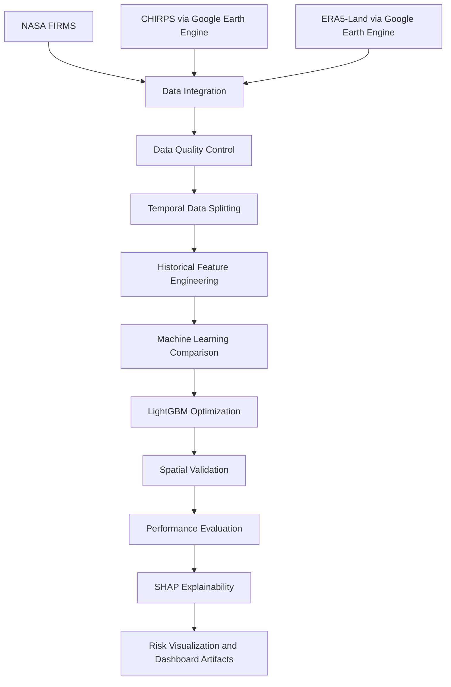
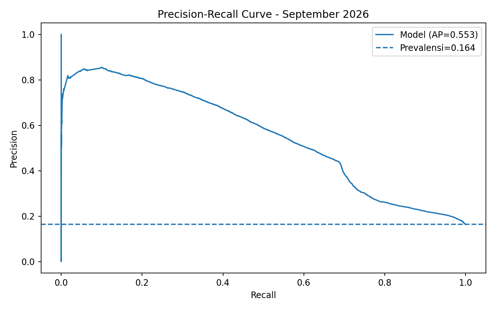
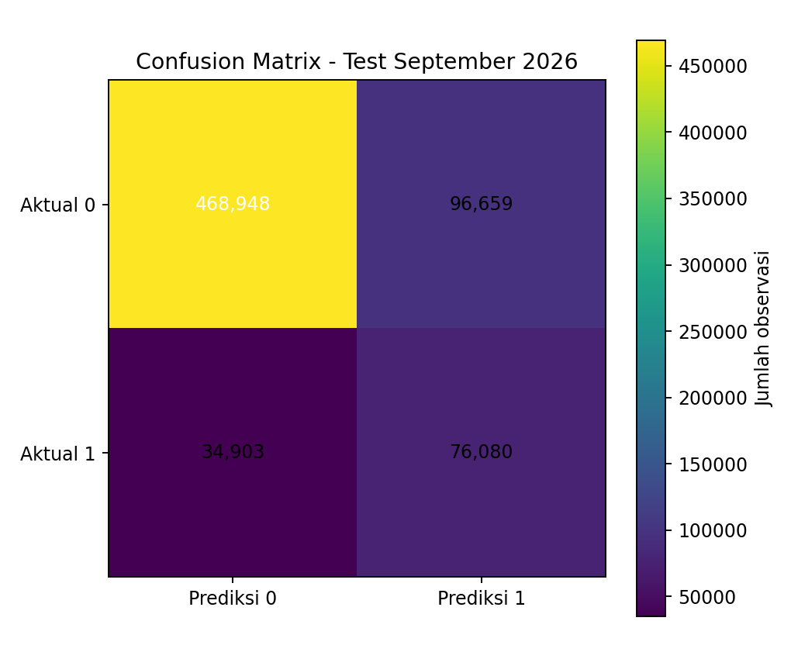
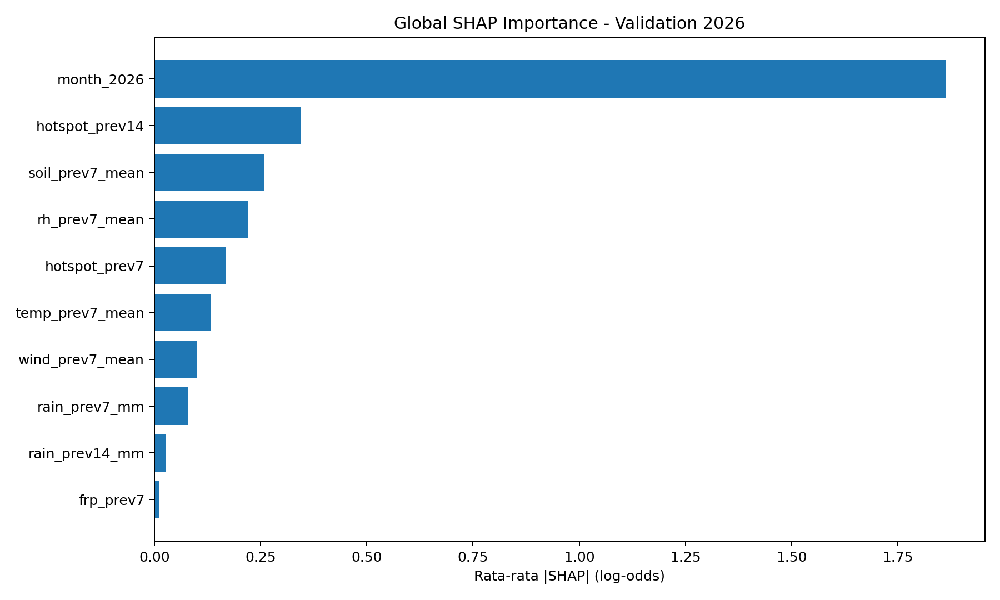

# 🌏 Leveraging Wildfire Data for Prevention, Response, and Disaster Mitigation Education in Kalimantan

**A Spatiotemporal Machine Learning Approach to Forest and Land Fire Hotspot Prediction in Indonesia**


---

## 📌 Project Overview

Forest and land fires (*Kebakaran Hutan dan Lahan*, or **Karhutla**) remain a significant environmental challenge in Indonesia, affecting ecosystems, public health, and local communities.

This project develops a **machine learning-based hotspot prediction system** using historical satellite observations, meteorological conditions, and spatial data.

The primary objective is to estimate the likelihood of hotspot occurrence within the **next seven days**, supporting data-informed prevention, response planning, and disaster mitigation education.

Although the project emphasizes Kalimantan, its current experimental dataset covers six provinces across Kalimantan and Sumatra.

### 🎯 Research Objectives

1. Integrate satellite hotspot detections with historical climate and weather data.
2. Develop spatiotemporal features for seven-day hotspot prediction.
3. Compare multiple supervised machine learning algorithms.
4. Improve predictive performance through feature engineering and hyperparameter optimization.
5. Interpret predictions using SHAP and feature importance.
6. Prepare research outputs for risk visualization and future dashboard development.

---

## 🗺️ Study Area

The research covers **six Indonesian provinces**:

| Kalimantan | Sumatra |
|---|---|
| Central Kalimantan | South Sumatra |
| West Kalimantan | Jambi |
| South Kalimantan | Riau |

The study uses **22,553 spatial grid cells** with an approximate spatial spacing of 0.045 degrees (roughly 5 km, depending on latitude).

---

## 📊 Dataset Overview

The integrated dataset combines observations from three primary sources.

| Data Source | Variables | Purpose |
|---|---|---|
| **NASA FIRMS** | Hotspot counts, Fire Radiative Power (FRP) | Historical fire detection |
| **CHIRPS** | Daily precipitation | Rainfall conditions |
| **ERA5-Land** | Temperature, relative humidity, soil moisture, wind speed | Meteorological conditions |

### Dataset Statistics

| Description | Value |
|---|---:|
| Study period | January–September 2026 |
| Provinces | 6 |
| Spatial grid cells | 22,553 |
| Total observations | **5,841,227** |
| Prediction horizon | 7 days |
| Target classes | 2 (Binary Classification) |
| Duplicate grid–date records | 0 |
| Missing CHIRPS precipitation | 0 |
| Rows containing missing ERA5 values | 73,038 |

Missing ERA5 measurements are preserved as `NaN` instead of being arbitrarily replaced with zero.

### Temporal Data Splitting

| Dataset | Period | Observations |
|---|---|---:|
| Training | January 1 – July 24, 2026 | 4,623,365 |
| Validation | August 1 – August 24, 2026 | 541,272 |
| Testing | September 1 – September 30, 2026 | 676,590 |

A seven-calendar-day gap is maintained between consecutive splits to reduce overlap involving the seven-day prediction target.

---

## 🧠 Machine Learning Methodology

### Problem Formulation

The research applies **Supervised Learning — Binary Classification**.

The prediction target is:

`y_7d`

- **Class 0:** No hotspot detected within the following seven days.
- **Class 1:** At least one hotspot detected within the following seven days.

The model produces a probability score that is converted into a binary prediction using a validation-selected decision threshold.

### Machine Learning Algorithms

Three algorithms were initially evaluated:

| Algorithm | Role |
|---|---|
| Logistic Regression (SGD) | Baseline comparison |
| Random Forest | Ensemble comparison |
| **LightGBM** | Selected primary model |

LightGBM was selected based on validation performance and subsequently improved using historical feature engineering and regularization.

### Historical Feature Engineering

The developed features include:

- Previous 7- and 14-day accumulated rainfall
- Historical hotspot counts
- Historical Fire Radiative Power
- Mean temperature over the previous seven days
- Mean relative humidity
- Historical soil moisture
- Historical wind speed
- Calendar month

Historical features are calculated using observations preceding the prediction date.

Future hotspot information, including `n_hot_next_7d`, is excluded from model inputs to prevent direct target leakage.

---

## 🔄 Research Workflow



---

## 🏆 Experimental Results

### Selected Model: Regularized LightGBM

The selected model achieved the following performance on the September 2026 test dataset:

| Evaluation Metric | Result |
|---|---:|
| **PR-AUC (Average Precision)** | **0.5533** |
| **ROC-AUC** | **0.8045** |
| **Precision** | **44.04%** |
| **Recall** | **68.55%** |
| **F1-Score** | **0.5363** |

These results use the F1-oriented decision threshold selected from validation data.

### Recall–Precision Trade-off

| Decision Threshold | Precision | Recall |
|---|---:|---:|
| F1-oriented (~0.1299) | 44.04% | 68.55% |
| Higher-recall (~0.0545) | 27.16% | 77.86% |

Lower thresholds detect more positive grid–date observations but increase the number of false alarms.

This trade-off is particularly relevant to disaster risk monitoring, where missed hotspot detections and unnecessary alerts may have different consequences.

### Spatial Validation

| Evaluation Subset | PR-AUC | F1-Score |
|---|---:|---:|
| Seen geographic locations | 0.5557 | 0.5562 |
| Held-out geographic locations | 0.4433 | 0.4780 |

The reduction in performance on held-out geographic blocks highlights an important challenge in spatial generalization.

The difference also reflects variation in hotspot prevalence and should not be interpreted as a purely spatial effect.

---

## 📈 Model Performance Visualization

### Precision–Recall Curve



### Confusion Matrix



### SHAP Feature Importance



SHAP is used to explain how historical features contribute to model predictions.

Positive SHAP values increase a model's raw prediction score, while negative values decrease it. These contributions explain model behavior, not causal relationships.

---

## 📁 Project Structure

```text
.
├── README.md
├── .gitattributes
├── .gitignore
│
└── karhutla/
    ├── config.yaml
    ├── requirements.txt
    │
    ├── src/
    │   ├── data/
    │   │   └── Data acquisition and processing scripts
    │   └── models/
    │       └── Training, tuning, validation, and SHAP scripts
    │
    ├── data/
    │   ├── raw/
    │   ├── interim/
    │   ├── processing/
    │   └── processed/
    │
    ├── notebooks/
    │   └── Exploratory analysis and model visualization
    │
    ├── results_orang_b/
    │   └── Historical model experiments and metrics
    │
    ├── reports/
    │   └── orang_b/
    │       └── Audit and evaluation reports
    │
    ├── figures/
    │   └── orang_b/
    │       └── Evaluation charts and SHAP plots
    │
    └── models_final/
        └── Model candidate and inference configuration
```

The repository preserves raw data separately from processed datasets and experimental outputs to support reproducibility.

---

## 🚀 Getting Started

### 1. Clone the repository

```bash
git clone <YOUR_REPOSITORY_URL>
cd <YOUR_REPOSITORY_FOLDER>
```

Large datasets and model artifacts are tracked using **Git LFS**.

```bash
git lfs install
git lfs pull
```

### 2. Install dependencies

```bash
cd karhutla
python -m pip install -r requirements.txt
```

Additional modeling dependencies, if needed:

```bash
python -m pip install lightgbm scikit-learn duckdb pyarrow pandas numpy matplotlib joblib
```

### 3. Explore the research outputs

The repository includes Python scripts and Jupyter notebooks for feature engineering, model evaluation, and explainability.

Recommended notebook:

`karhutla/notebooks/Analisis_Model_2026.ipynb`

The candidate model is stored in:

`karhutla/models_final/lightgbm_candidate_2026.joblib`

Its feature specification and decision thresholds are documented in:

`karhutla/models_final/model_spec_2026.json`

The full GEE extraction process requires configured Earth Engine access. Existing experiments can be inspected without repeating the original data downloads.

---

## 🔍 Evaluation and Research Integrity

The project emphasizes reproducible experimentation and transparent reporting.

Important methodological considerations include:

1. Training, validation, and testing are separated temporally.
2. Future hotspot labels are excluded from prediction features.
3. Hyperparameter and threshold selection rely on validation data.
4. Geographic block holdout is used as an additional diagnostic.
5. Model explanations are generated using SHAP.
6. Missing meteorological observations are not automatically treated as zero.

**Important:** The September test dataset was viewed during earlier baseline comparisons and is therefore not an untouched independent holdout. Reported test metrics should be interpreted as retrospective research results.

---

## ⚠️ Limitations and Future Development

The current model is a **research prototype**, with several limitations:

- Hotspot detections do not necessarily represent independently confirmed forest fires.
- The modeling period is limited to 2026.
- Cross-year generalization has not been established.
- Meteorological data publication delays have not been fully evaluated for operational forecasting.
- Model performance varies across provinces and geographic regions.
- Predicted probabilities have not been fully calibrated for operational risk communication.

Potential future developments include probability calibration, additional historical periods, independent temporal validation, stronger spatial testing, and integration with a geographic risk dashboard.

---

## 🤝 Project Collaboration

This repository was developed for the **DIMAS-TI 2026 Data Mining Project**, integrating work across data engineering, machine learning, and visualization.

The project structure supports reproducibility and collaboration while maintaining the original data sources and historical experiment artifacts.

### Data Sources

- NASA FIRMS — Fire Information for Resource Management System
- CHIRPS — Climate Hazards Group InfraRed Precipitation with Station Data
- ECMWF ERA5-Land — Reanalysis meteorological data
- Google Earth Engine — Geospatial data access and processing

---

### 🌱 Toward Data-Driven Wildfire Mitigation

*Transforming historical environmental observations into interpretable hotspot risk insights for disaster prevention and preparedness.*

**DIMAS-TI 2026 | Indonesia | Machine Learning & Geospatial Analytics**
